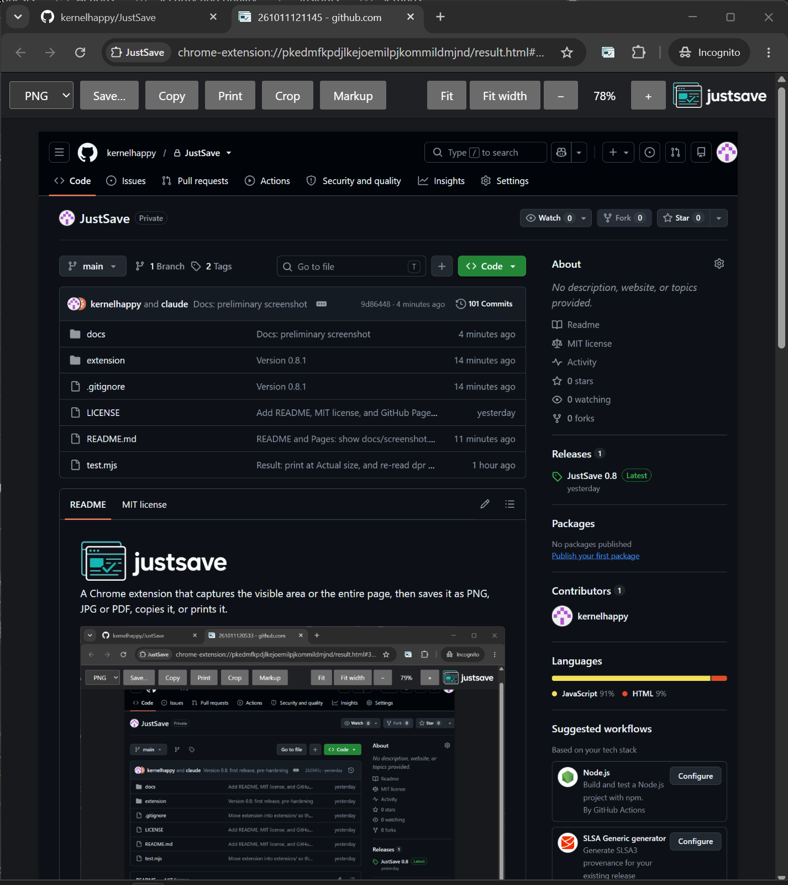

<picture>
  <source srcset="docs/logo-dark.png" media="(prefers-color-scheme: dark)">
  
</picture>

A Chrome extension that captures the visible area or the entire page, then saves it as PNG, JPG or PDF, copies it, or prints it.

<!-- Screenshot: add docs/screenshot.png, then uncomment.

-->

## Features

- **Three capture modes**
  - **Visible area**: what's on screen right now.
  - **Full page**: scrolls the page and stitches the frames. Lazy-loaded content gets loaded first, sticky headers appear once instead of in every frame, and input is blocked while it works.
  - **Full page (fast)**: one shot through Chrome's DevTools protocol. It's faster and has no seams, but full-height sections can stretch and embeds can come out blank.
- **PNG, JPG or PDF**, with High, Medium and Low quality for JPG and PDF. PDFs are split into Letter pages, cut at the least busy row so text isn't sliced in half.
- **Zoom** the preview (Fit, Fit width, − / +) and **Crop** it to the part you want before saving.
- **Markup** the preview: highlighter, pen, line, arrow, rectangle, ellipse, cloud, text and callout. A filled box redacts: it is burned into the saved, copied or printed image, so the pixels underneath are gone.
- **Save…** (Chrome reopens the folder you used last), **Copy** (as PNG) or **Print**.
- Remembers your last format and quality. Files are named like `261009104405 - www.example.com`.

## Limitations

- **Full page** follows the page's main scrollbar. Apps that scroll an inner panel instead (many web apps) capture only what's on screen, and so do right-to-left pages wider than the window.
- **Full page** stops after 100 screens. The result tab says so when it happens.
- Very large captures are scaled down to fit Chrome's canvas limits (32,767 px per side, 268 megapixels).
- Chrome doesn't let extensions run on its own pages, the Chrome Web Store, or `file://` pages (unless file access is allowed). There, only **Visible area** can work.
- Markup is burned in by **Save**, **Copy**, the **Print** button and Ctrl+P. Printing from Chrome's menu (⋮ → Print) prints the live page with the markup as a removable vector layer, so don't rely on it for redaction.

## Install

1. Download `JustSave-x.y.zip` from the [latest release](https://github.com/kernelhappy/JustSave/releases/latest) and unzip it.
2. Open `chrome://extensions` and turn on **Developer mode** (top right).
3. Click **Load unpacked** and select the unzipped `JustSave` folder.

## Permissions

| Permission | Why |
|---|---|
| `activeTab` | Capture the tab you clicked the extension on, and only that tab. |
| `scripting` | Scroll the page and hide repeating sticky headers during a full-page capture. |
| `debugger` | **Full page (fast)** only. Chrome shows a "started debugging this browser" bar while it runs. |

## Privacy

JustSave makes no network requests and has no analytics. Captures stay in your browser until you save them.

## Development

The extension lives in `extension/`. Load it unpacked from there.

```
node test.mjs     # PDF writer, page-break and markup tests
```

Release:

```
# bump "version" in extension/manifest.json, commit, push
git archive --format=zip --prefix=JustSave/ -o JustSave-X.Y.zip HEAD:extension
gh release create vX.Y JustSave-X.Y.zip
```

## License

[MIT](LICENSE)
